# Philippos Dragon

 

<picture>
  <source media="(prefers-color-scheme: dark)" srcset="https://raw.githubusercontent.com/PhilipposDragon/PhilipposDragon/main/profile-3d-contrib/profile-night-green.svg" />
  <source media="(prefers-color-scheme: light)" srcset="https://raw.githubusercontent.com/PhilipposDragon/PhilipposDragon/main/profile-3d-contrib/profile-green.svg" />
  
</picture>

### stats

